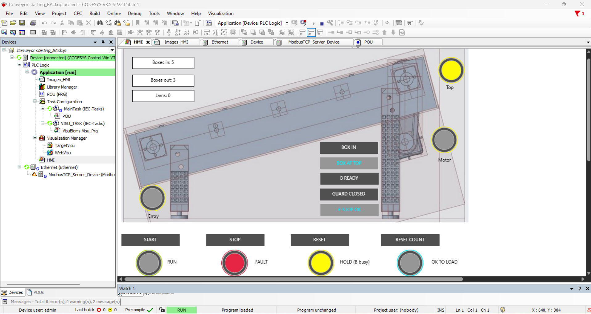
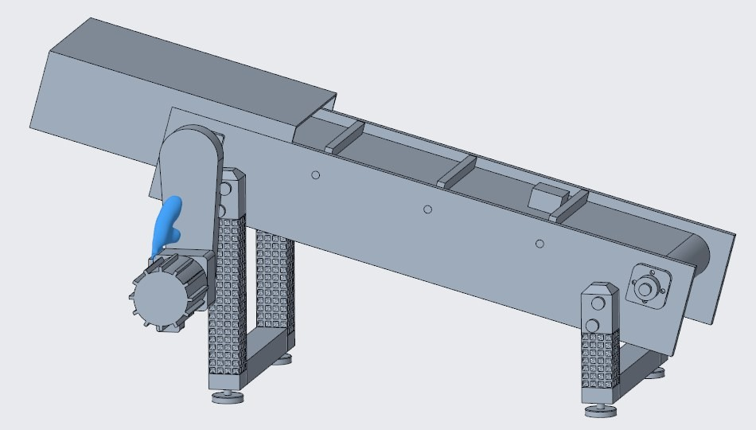
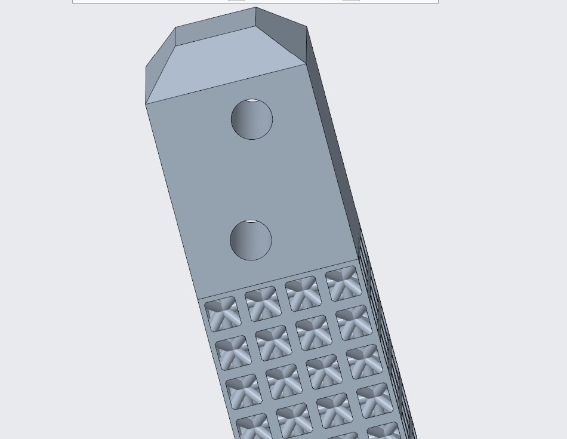
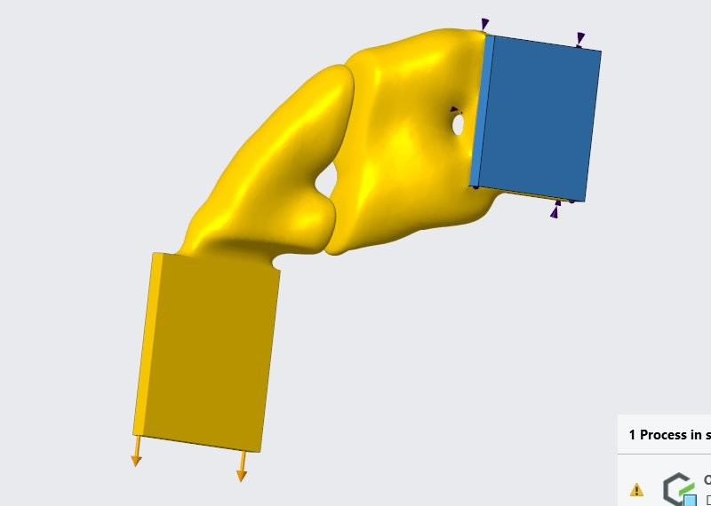
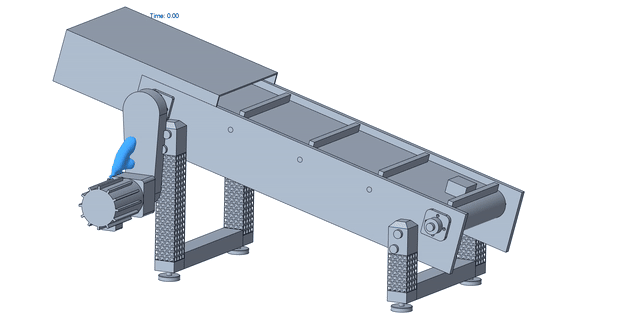
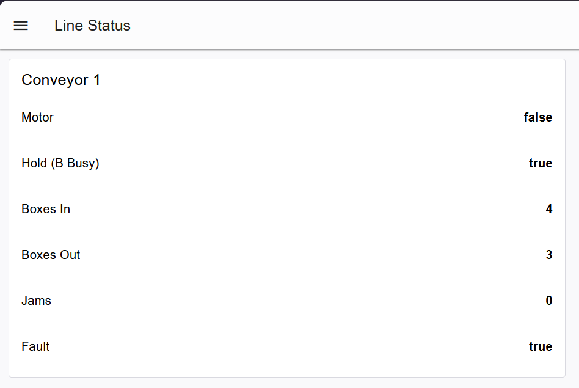

# Smart Inclined Conveyor (PLC + HMI + Node-RED dashboard)

This is a side project I did during my master's in Connected Industry 4.0 at UC3M. I wanted some hands-on PLC practice, so I took the inclined conveyor I modelled in PTC Creo for a course project and wrote the control program for it in CODESYS. After that I made an HMI for it and sent the machine data to a small web dashboard using Modbus TCP, Node-RED and MQTT.

Data path: Creo model -> CODESYS PLC (ladder) -> CODESYS HMI, and PLC -> Modbus TCP -> Node-RED -> MQTT (Mosquitto) -> web dashboard.

## The conveyor

It's a small belt conveyor with cleats, going up at 15 degrees. The idea is that station A puts a box at the bottom and station B takes it at the top.

I took the timings for the PLC from the Creo model. The belt moves at 26.2 mm/s (50 mm roller with a 1.67:1 belt drive) and the two sensors are about 500 mm apart, so a box needs around 19 s to get to the top. I set the jam timeout to 25 s to leave some margin. The cleats are 150 mm apart, which means one passes every 5.73 s, so that's the minimum gap between loading two boxes. The model also has a belt guard and a head cover, so I added a guard interlock.

The Creo model started as a group course project at uni. I did all the Creo modelling myself, and my teammates did the 3D printing prep and the report. The PLC, HMI and Node-RED parts in this repo are also my own.

## Creo design

The model has 18 parts. The idler roller sits in a slot so the belt can be tensioned, and three small carrier rollers stop the belt from sagging. The motor drives the head roller through a small belt drive (30 mm to 50 mm pulley). The two leg heights differ by 129.4 mm (500 x sin 15), which gives the 15 degree slope while keeping the legs vertical. I checked the whole assembly with Global Interference and fixed the clashes it found until there were none left.

The legs have a lattice section in the middle (10 mm cube cells, 2.5 mm beams), which saves about 37% of the PLA compared to solid legs. The ends stay solid because that's where the bolts go.

I also tried generative design for the bracket that holds the motor to the tall leg. With a 150 N load and a 12% volume limit it came out at about 130 g, with a safety factor of around 27 on PLA.

For the animation I put the drive roller on a pin joint and moved the cleats on a slider at the real belt speed (26.2 mm/s), with a box riding up the belt.

## PLC program

Everything is in one ladder program (`POU`) with 17 rungs. What it does:

- The motor can only run if the E-stop is OK, the guards are closed and there's no jam.
- Start/stop with a seal-in contact. If a guard opens or a fault happens, it doesn't restart on its own, you have to press Start again.
- The entry sensor sets `Box_On_Belt` and the top sensor resets it.
- Jam check with a 25 s TON. If the box doesn't get to the top in time, the motor stops and the fault lamp comes on. Reset clears the fault and the stuck box.
- A 5.73 s TON blocks loading until the next cleat comes (`OK_To_Load`).
- If a box is at the top and station B is busy, the belt pauses and starts again by itself when B is ready. I treated this as a pause, not a fault.
- CTU counters for boxes in, boxes out and jams.

Inputs: Start, Stop, Reset, Counter_Reset, EStop_OK, Guard_Closed, S_Entry, S_Top, Station_B_Ready

Outputs and internal signals: Motor, Lamp_Run, Lamp_Fault, Hold_At_Top, OK_To_Load, Boxes_In, Boxes_Out, Jams

## HMI

I made the HMI in CODESYS Visualization and used a side view of the Creo model as the background. It has the start/stop/reset buttons, lamps for run, fault, hold and OK to load, lamps on the sensors and motor, and the counters. Since there's no real machine, I also added some buttons to fake the sensors and station B for testing.

## Modbus and Node-RED

The soft PLC (CODESYS Control Win V3) runs a Modbus TCP server on port 502. I mapped the data to 4 input registers:

| Register | What's in it |
|---|---|
| 0 | status bits (bit 0 motor, 1 fault, 2 hold, 3 OK to load, 4 entry sensor, 5 top sensor) |
| 1 | boxes in |
| 2 | boxes out |
| 3 | jams |

Node-RED reads these every second (FC 4), a function node splits the status word into separate values, and the result goes out as JSON on the MQTT topic `factory/conveyor1/status` (local Mosquitto broker). Another flow subscribes to that topic and shows the values on a FlowFuse Dashboard 2.0 page.

## Files

- `Smart conveyor.project` CODESYS project
- `flows.json` Node-RED flow, can be imported directly
- `HMI.png`, `Flow in Node-Red.png`, `Dashboard.png` screenshots
- `Conveyor PLC HMI Screenshots.docx` screenshots of all the ladder rungs and the tests
- `creo_files_part1.zip` and `creo_files_part2.zip` Creo parts and assemblies (unzip both into the same folder, then open `conveyor.asm`). I had to split it in two because of the GitHub upload size limit.
- `creo_assembly.png`, `creo_lattice_leg.png`, `creo_gd_bracket.png`, `conveyor_mechanism.gif` Creo screenshots and the mechanism animation

## Running it

You need CODESYS V3.5 (I used SP22) with CODESYS Control Win V3 x64 started. Open the project, go to Ethernet > Browse and pick your network adapter, then build, log in and start. For the Node-RED side you need Node.js, Node-RED, node-red-contrib-modbus, @flowfuse/node-red-dashboard and Mosquitto. Import the flow and deploy. The Modbus client connects to 127.0.0.1:502, and the dashboard is at http://localhost:1880/dashboard.

The soft PLC is in demo mode, so it stops after about 2 hours. You just restart it from the tray icon.

## What I want to add

An automatic simulation mode (so the box travels by itself), the same PLC logic in Siemens TIA Portal on an S7-1200, and maybe logging to a database to show throughput.

Tools used: PTC Creo (lattice, generative design, mechanism), CODESYS V3.5 (ladder, IEC 61131-3), CODESYS Visualization, Modbus TCP, Node-RED, MQTT/Mosquitto, FlowFuse Dashboard 2.0
